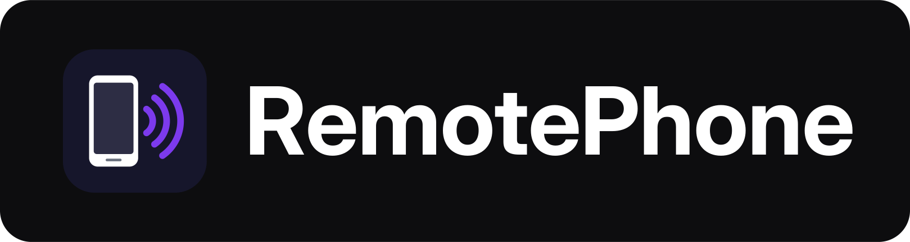

<p align="center">
  <picture>
    <source media="(prefers-color-scheme: dark)" srcset="assets/logo-dark.png">
    <source media="(prefers-color-scheme: light)" srcset="assets/logo-light.png">
    
  </picture>
</p>

<p align="center">
  <strong>Mirror and control your Android phone from your desktop, no USB debugging required.</strong>
</p>

RemotePhone is a two-part system: an Android app that captures and streams your phone's screen, and a client that displays the stream and lets you control the phone with your mouse and keyboard. The client is a desktop app for Linux, macOS and Windows, or a page in your browser.

Unlike scrcpy (which requires ADB/USB debugging), RemotePhone works entirely over WiFi using standard Android APIs.

---

## Features

- **Screen mirroring over WiFi** at up to native resolution and 60 fps, with H.264 hardware encoding
- **Full remote control**: tap, drag, long press, scroll, system keys. On Android 8+ a drag or trackpad scroll moves the phone as your hand moves
- **Keyboard input** into phone text fields, including the PIN pad, with copy and paste between the two clipboards
- **Audio mirroring** with automatic phone speaker muting (Android 10+)
- **No USB debugging**: no ADB, no developer mode needed
- **Approval on the phone** before a computer can see or control the screen, over an encrypted connection
- **Auto-discovery and auto-reconnect** on the local network
- **Wake on input** and **landscape support** that turns the desktop window with the phone
- **Browser client**: mirror and control from a static web page, nothing to install

## Architecture

```
┌──────────────────────┐    WebSocket over TLS (WiFi)     ┌──────────────────────┐
│    Android Phone     │ <------------------------------> │   Desktop Client     │
│                      │                                  │                      │
│  MediaProjection --> │  H.264 video frames ---------->  │  PyAV decoder        │
│  MediaCodec H.264    │  Raw PCM audio --------------->  │  sounddevice player  │
│  AudioPlaybackCapt.  │  <-- Touch/key JSON commands --  │  PyQt6 display       │
│  AccessibilityServ.  │                                  │  Mouse/keyboard      │
└──────────────────────┘                                  └──────────────────────┘
```

The browser client takes the desktop client's place, with WebCodecs and Web Audio doing the decoding.

---

## Setup

### 1. Android App

Android 7.0+. Audio mirroring needs Android 10+.

1. Install it from [F-Droid](https://f-droid.org/packages/com.remotephone/) or download the APK from [Releases](https://github.com/dpk404/remote-phone/releases). To build it yourself, open `android/` in Android Studio and click **Run**
2. **Android 13+ only:** Go to **Settings -> Apps -> RemotePhone -> ⋮ menu -> "Allow restricted settings"** (required for sideloaded apps to use accessibility)
3. Open the app and tap **Remote control** under Setup -> find **RemotePhone** -> **Enable** it

### 2. Desktop Client (Linux, macOS, Windows)

Needs Python 3.10+.

```bash
sudo apt install libportaudio2   # Linux only (Debian/Ubuntu), for audio playback
pip install remote-phone
remotephone
```

**From source:** clone the repo, or take `RemotePhone-linux-<version>.tar.gz` from [Releases](https://github.com/dpk404/remote-phone/releases). `./run.sh` on Linux and macOS creates a virtual environment and installs the package into it (Linux also needs `python3-venv`). On Windows, run `pip install -e .` in a virtual environment, then `remotephone`.

**macOS app (no Python needed):** download `RemotePhone-<version>-macos-arm64.dmg` from [Releases](https://github.com/dpk404/remote-phone/releases) and drag RemotePhone into Applications. The app is not notarized, so macOS blocks the first launch: click **Open Anyway** in **System Settings -> Privacy & Security**, or run `xattr -d com.apple.quarantine /Applications/RemotePhone.app`. To build it yourself: `pip install -e . pyinstaller && tools/build_mac.sh`.

### 3. Web Client (optional, nothing to install)

A static browser client: mirroring, control, typing, clipboard and audio, without the network scan, so you type the phone's address. Use the hosted copy at <https://dpk404.github.io/remote-phone/> or open `web/index.html` directly. Open `https://<phone-ip>:8765` once to accept the phone's certificate, then connect. See [web/README.md](https://github.com/dpk404/remote-phone/blob/main/web/README.md).

---

## Usage

1. **On your phone:** open RemotePhone, tap **Start mirroring** and grant the screen capture permission
2. **On your computer:** run the desktop client. It scans the network and connects if it finds one phone. With several, pick one from the list. If none shows up, enter the phone's IP (shown in the app) and click **Connect to address**; the last address is remembered
3. **Back on the phone:** tap **Allow** on the connection request, which shows as a notification and as a card on the app's main screen. The picture shows up at once
4. **To finish:** tap **Stop mirroring** in the app, or **Stop** on its notification

Two switches on the Connect screen turn off the scan at launch and the once-per-launch check with PyPI for a newer version.

### Who may connect

Every decision is made on the phone; the desktop never asks anything.

- A computer gets neither video nor control until you tap **Allow**. Deny, or no answer within a minute, closes the connection and the desktop shows why.
- Allow lasts for the current mirroring session. With **Remember allowed computers** on in the app's Settings, it lasts until you tap **Forget** next to that computer.
- Settings also has **Ask before a computer connects** (on by default; off lets any computer on the network watch and control the phone) and **Allow several computers at once** (off by default).
- While mirroring, the app's main screen lists every computer that is watching, each with a **Disconnect** button that also ends its approval for this session. **Stop mirroring** closes every connection.

### Controls

| Input | Action |
|-------|--------|
| Left click | Tap |
| Click + drag | Drag (live on Android 8+, a swipe on release on Android 7) |
| Hold click (> 0.5s) | Long press |
| Scroll wheel / two-finger scroll | Scroll |
| Two-finger swipe right / right click / middle click / Escape | Back |
| Home key | Home |
| F2 / F5 / F6 | Recent apps / Notifications / Quick Settings |
| F10 | Lock screen (Android 9+) |
| F11 | Fullscreen toggle |
| Typing, Delete, Enter | Go to the focused text field |
| Backspace | Delete character (or Back if no text field) |
| Ctrl+A / C / X / V (Cmd on macOS) | Select all / Copy / Cut / Paste. Copy and cut also land on the desktop clipboard, and paste types what is on it |

Back, Home, Recents, Alerts and Lock are also buttons under the picture.

### Typing

On Android 13+ typing goes through the phone's real input pipeline with nothing to set up, including text fields inside web pages. On Android 12 and older, enable and select the **RemotePhone Keyboard** (the Remote typing row under Setup opens the settings) for the same result; without it, typing falls back to accessibility text actions, which some apps and browsers ignore. On a PIN pad such as the lock screen, digits press the matching on-screen buttons and Enter presses the confirm button.

Copy and cut reach the desktop clipboard on Android 13+. On Android 10 to 12 that needs the RemotePhone Keyboard selected.

### Audio

Click the speaker button above the picture in the desktop client, or switch on **Mirror audio too** in the phone app; each side follows the other. The phone speaker is muted while audio is streamed. Requires Android 10+, and `libportaudio2` on Linux.

---

## Protocol

WebSocket over TLS on port **8765**, with a self-signed certificate the phone keeps in its keystore. H.264 video and PCM audio go to the client, and JSON commands come back. The message formats, the handshake and the encoder settings are in [PROTOCOL.md](https://github.com/dpk404/remote-phone/blob/main/PROTOCOL.md).

## Known Limitations

- **Lock screen and secure screens** (banking apps, DRM content) display as black. This is an Android security restriction on MediaProjection. You can still type your PIN from the keyboard.
- Both devices must be on the **same WiFi network**.
- Some device manufacturers restrict the AccessibilityService or MediaProjection. On some phones, system Settings and a few protected apps can show a black picture or switch remote control off while they are open. The indicator at the top of the client shows **Control off** until control returns.
- Clearing the app's data on either side, or reinstalling, makes a remembered computer ask for approval again.

## License

MIT
